<p align="center">
  
</p>

<h1 align="center">Enan · عِنان</h1>

<p align="center">
  <strong>A self-hosted executive office.</strong><br>
  Tasks, meeting notes, committees, KPIs and the people who own them, on your own server.
</p>

<p align="center">
  <a href="LICENSE"></a>
  <a href="#status-and-roadmap"></a>
  <a href="#quick-start"></a>
  <a href="#quick-start"></a>
  
</p>

<p align="center">
  <a href="https://enan.ing"><strong>enan.ing</strong></a>
  &nbsp;·&nbsp;
  <a href="#quick-start"><strong>Quick start</strong></a>
  &nbsp;·&nbsp;
  <a href="https://ta.sa"><strong>ta.sa</strong></a>
</p>

<br>

<p align="center">
  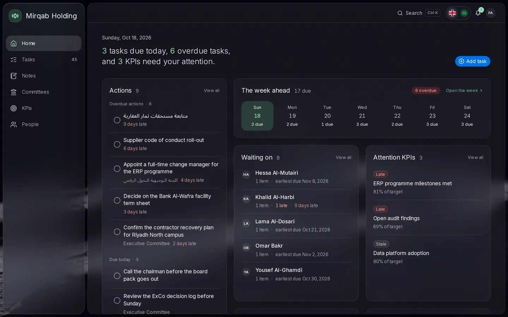
</p>

<p align="center"><sub>The company, people and numbers in the screenshots are invented.</sub></p>

## What it is

Enan is for an executive and the small office around them. It holds the work that usually ends up spread across email, spreadsheets and someone's notebook: what is due, who owes what, what the board agreed, and which KPIs are slipping.

It runs as one Docker container with its data in one SQLite file. There is no database server, no separate worker and no subscription. It is bilingual, English and Arabic, with right-to-left support. AI is optional, off by default, and [never changes anything on its own](#ai-that-proposes-you-decide).

## Tour

<table>
  <tr>
    <td width="50%" valign="top">
      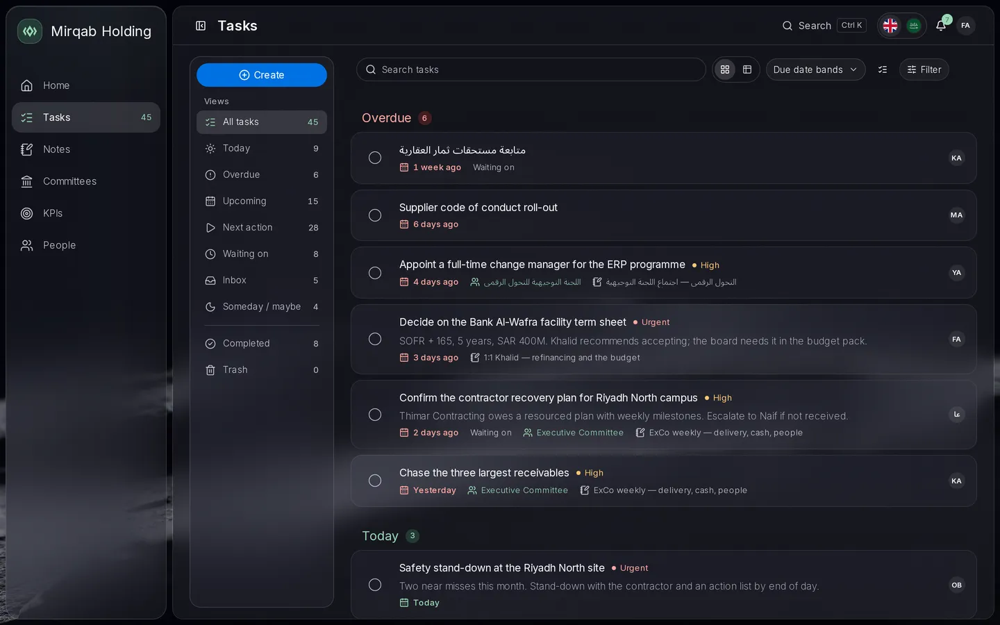<br>
      <sub><b>Tasks.</b> Grouped by due date, from Overdue to No date.</sub>
    </td>
    <td width="50%" valign="top">
      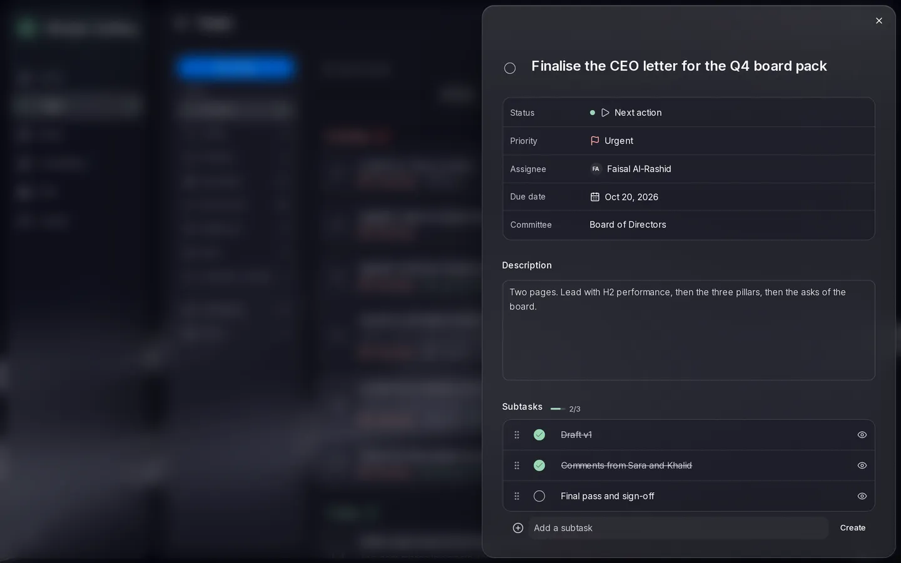<br>
      <sub><b>A task.</b> Owner, due date, committee and subtasks, beside the list.</sub>
    </td>
  </tr>
  <tr>
    <td width="50%" valign="top">
      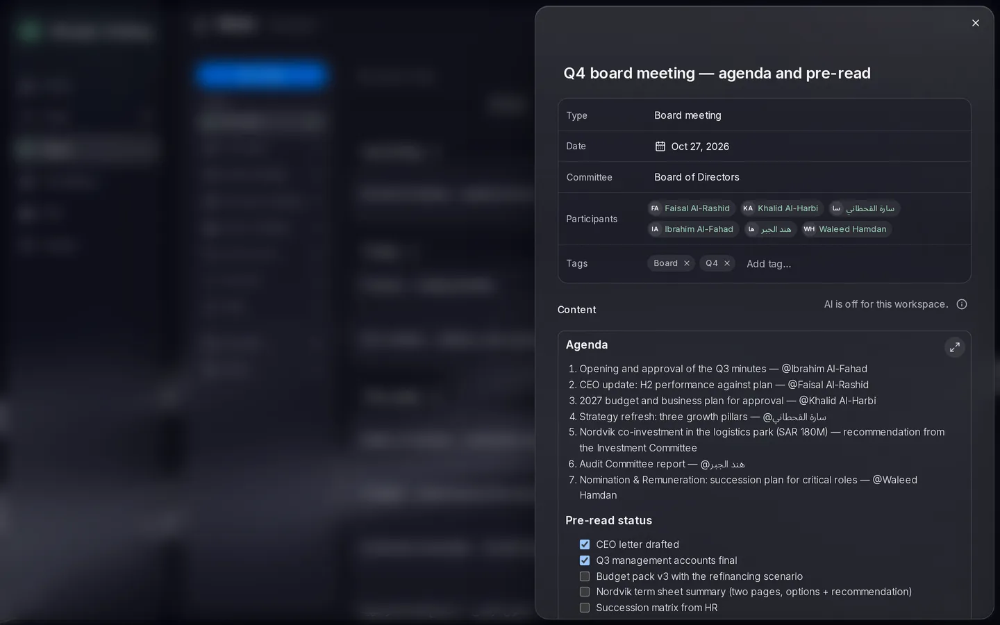<br>
      <sub><b>A board-meeting note.</b> Agenda, participants, @mentions and the pre-read.</sub>
    </td>
    <td width="50%" valign="top">
      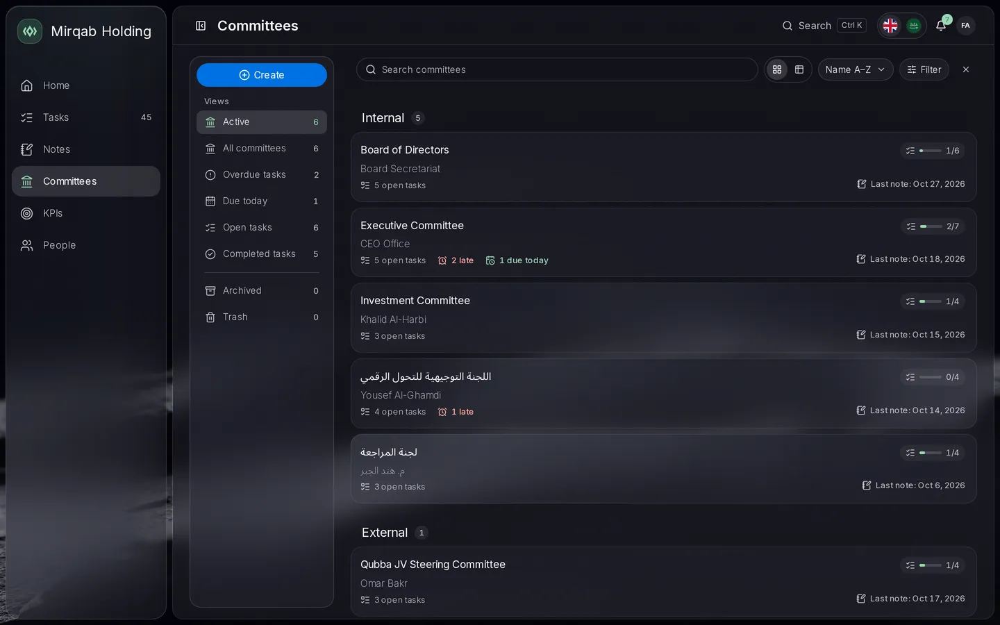<br>
      <sub><b>Committees.</b> Each with its open tasks, late tasks and last note.</sub>
    </td>
  </tr>
  <tr>
    <td width="50%" valign="top">
      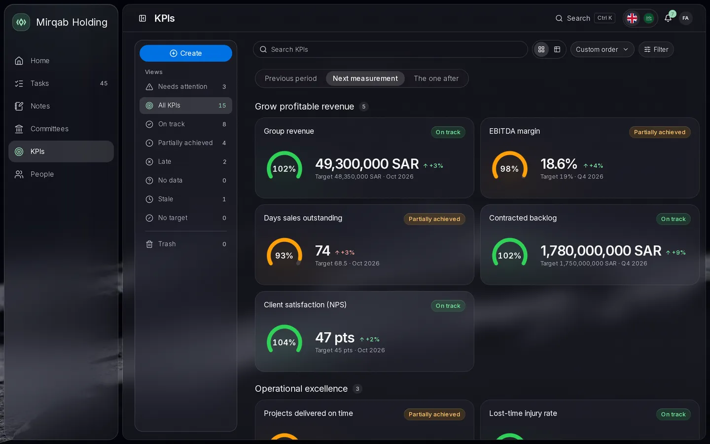<br>
      <sub><b>KPI scorecard.</b> Status is computed. Nobody colours it green by hand.</sub>
    </td>
    <td width="50%" valign="top">
      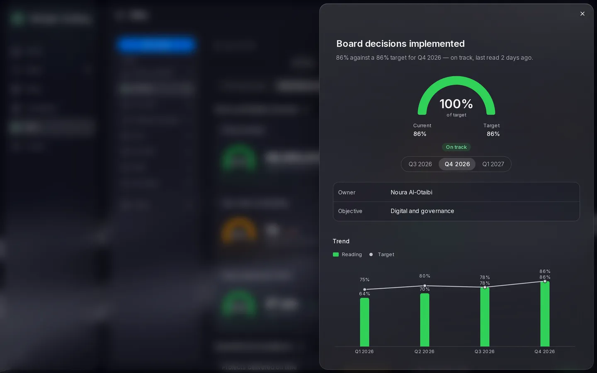<br>
      <sub><b>A KPI.</b> Reading against target, the reason for its status, and the trend.</sub>
    </td>
  </tr>
  <tr>
    <td width="50%" valign="top">
      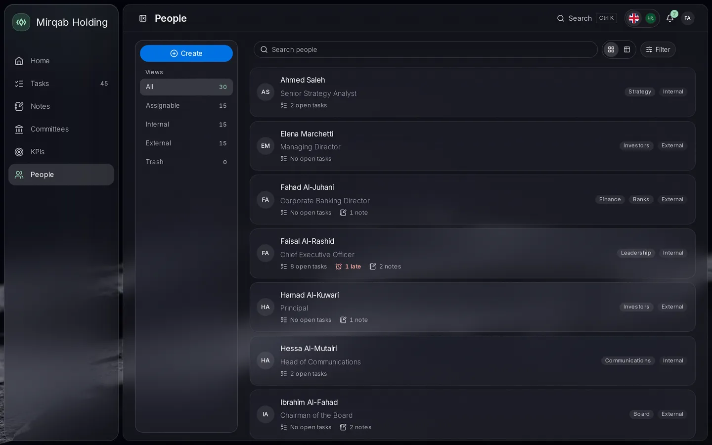<br>
      <sub><b>People.</b> A light directory. Open a name, see what is still on their plate.</sub>
    </td>
    <td width="50%" valign="top">
      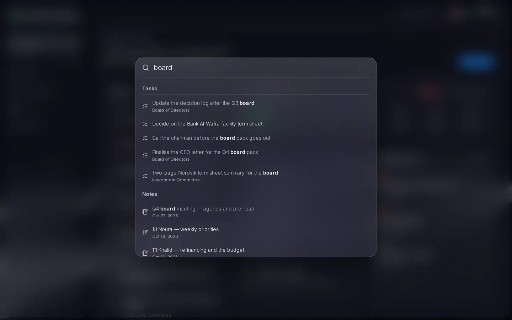<br>
      <sub><b>Search.</b> <kbd>Ctrl</kbd> <kbd>K</kbd>, one list across every module.</sub>
    </td>
  </tr>
</table>

<details>
<summary><b>The same app on a phone, in English and in Arabic</b></summary>
<br>
<table>
  <tr>
    <td>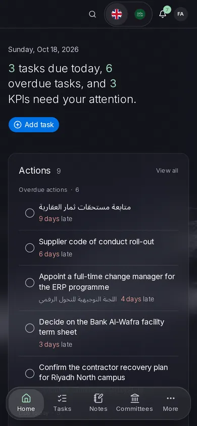</td>
    <td>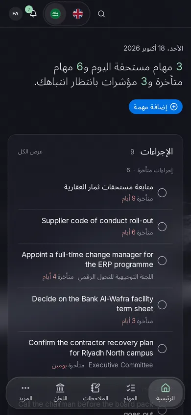</td>
  </tr>
</table>

It is a responsive web app. Phones use it in the browser, and there is nothing to install from a store. Each person picks their own language.
</details>

## What works today

- **Home**: what is due today, what slipped, the week ahead, who you are waiting on, and KPIs that need a look.
- **Tasks**: owners, priorities, subtasks, due-date bands, links to a committee, and a trash you can restore from.
- **Notes**: meeting notes with type, date, committee, participants and @mentions.
- **Committees**: the board, the ExCo and other standing bodies, each with its own tasks and notes.
- **KPIs**: objectives, readings and targets. Status (On track, Late, Stale, No data) is computed, and the reason is shown next to it.
- **People**: a light directory, with each person's open tasks.
- **Search**: one box across tasks, notes, committees, KPIs and people.
- **Admin**: users, settings, AI, backups, jobs and an audit log. Notifications are in-app.

## AI that proposes, you decide

AI in Enan does three small, useful things, and none of them writes anything until you say so. It is off until an administrator adds a key. Automatic actions taken by AI without your confirmation are written into the spec as a permanent non-goal.

### Refine a note

You type the note the way notes get typed in a meeting. Enan turns it into a clean, structured note and pulls out the action items it found.

```text
exco sun. revenue fine. dso still 74, need under 70 by q4.
khalid to chase top 3 receivables before thurs.
noura shortlist 2 erp change managers next wk.
ceo letter v1 done, waiting on sara + khalid comments
```

What comes back is a proposal, laid out for review:

1. **A suggested rewrite**, with sections that fit the note: meeting, planning or general. Read it alone, read your original, or put them side by side. A one-line _What changed_ says what it did. If the note was already tidy, it changes little. It does not invent facts.
2. **Suggested tasks**, under _Also create_. Each one shows the sentence it came from. The owner is matched to a person in your workspace, or left empty if nobody fits. A task can carry a due date. Titles are editable, and each has a checkbox.

   | Keep | Task                                | Owner           | Due       | From                                             |
   | :--: | ----------------------------------- | --------------- | --------- | ------------------------------------------------ |
   |  ☑   | Chase the three largest receivables | Khalid Al-Harbi | Thursday  | “khalid to chase top 3 receivables before thurs” |
   |  ☐   | Shortlist two ERP change managers   | Noura Al-Otaibi | next week | “noura shortlist 2 erp change managers next wk”  |

3. **Suggested tags**, as chips.

You tick what to keep. The button says exactly what will happen, for example _Use rewrite and create 1 task_, and the tasks it creates are linked to the note. Discard has Undo.

<sub>The note and the table illustrate the shape of a proposal. They are not a transcript of a model's output.</sub>

A note written in a mix of Arabic and English is refined into Arabic, with names, mentions and technical terms kept as written.

### Break down a task

A task like _Prepare the Q4 board pack_ comes back as up to eight suggested subtasks. Each can have a due date, never later than the parent's. You tick the ones to add. Applying twice does not create duplicates.

### Suggest tags

Up to five tags for a task or a note, preferring the tags you already use.

### How a proposal moves

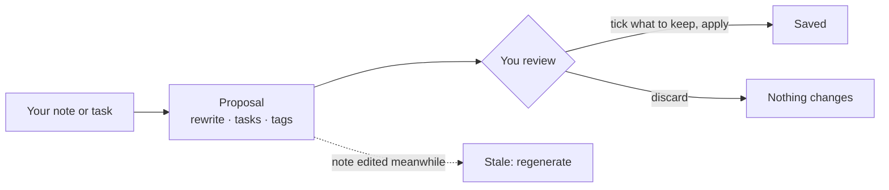

### What you can rely on

- **Nothing is written until you apply.** Generated content never replaces your data on its own.
- **Stale proposals cannot be applied.** If the note changed after the proposal was made, Enan says so and offers to regenerate.
- **You can cancel** while it is thinking.
- **Your content is treated as data.** Instructions hidden inside a note are ignored, and there are tests that try.
- **Email addresses are never sent.** The admin page lists exactly what is: the task or note content, the existing tags, and the names of people who can be assigned work.
- **No key, no AI.** Without one, nothing leaves your machine.

### What the administrator controls

| Control              | What it does                                                                                                                                                                                   |
| -------------------- | ---------------------------------------------------------------------------------------------------------------------------------------------------------------------------------------------- |
| Your own key         | An [OpenRouter](https://openrouter.ai) key, saved in **Admin → AI**. It is stored encrypted, never shown again, can be tested, and takes effect without a restart. You pay for your own usage. |
| Model choice         | A default model for refining and breaking down, and a fast model for tags. Any OpenRouter text model with structured outputs can be chosen, Claude for example.                                |
| Per-feature switches | Refine, breakdown and tag suggestions are turned on or off separately.                                                                                                                         |
| Monthly budget       | A cap in US dollars, with a warning at 80%. Each person also has an hourly limit: 30 refines or breakdowns, 60 tag suggestions.                                                                |
| Usage                | Calls and estimated cost per capability over the last 30 days.                                                                                                                                 |

### Coming

Not built yet: meeting briefs drafted from board papers (PDF or DOCX), with an executive summary and a critical review; learnings that improve later briefs; and drafts of initiative status updates. They will follow the same rule: proposed, then reviewed.

## Quick start

You need Docker with Compose.

```bash
git clone https://github.com/tsubaie/enan.git && cd enan
cp .env.example .env
```

Edit `.env` and set:

- `SESSION_SECRET`: a random string of at least 32 characters, for example the output of `openssl rand -hex 32`.
- `APP_URL`: the address people will open, for example `http://localhost:3000`.

Leave `DATABASE_URL` as it is, because it points at the data volume. Then run:

```bash
docker compose pull
docker compose up -d
docker compose logs app | grep SETUP_TOKEN
```

Open http://localhost:3000 and finish setup with that token. Migrations run on start. `docker compose pull` fetches the published image (`ENAN_TAG` in `.env`: `latest` is the newest release, `edge` the newest main that passed every check, or pin a version such as `0.2`). To build from this checkout instead, run `docker compose up -d --build`.

### Updating

Take a backup first (see [Data and backups](#data-and-backups)), then:

```bash
git pull                 # the compose file and .env.example may change between releases
docker compose pull
docker compose up -d
```

Migrations run on start. Each release is listed on the [Releases](https://github.com/tsubaie/enan/releases) page; to be told about new ones, choose **Watch → Custom → Releases** on GitHub. A release whose notes carry a **Rollback** warning changes the database in a way the previous release cannot read (ADR 0050): keep the backup until you are sure you will stay on it.

An install built from source with `--build` moves to the published image with `docker compose pull && docker compose up -d` in the same folder; its volumes are kept. A clone in a new folder starts with new, empty volumes, because Compose names the volumes after the folder.

### Automatic updates

The optional `updater` service keeps the app on the newest image of its channel ([ADR 0051](docs/adr/0051-installs-update-themselves.md)). Turn it on with:

```bash
docker compose --profile autoupdate up -d
```

Every 15 minutes it checks the registry. When a new image is out, it:

1. takes a backup;
2. replaces the app container with one on the new image;
3. waits for the new version to report itself healthy.

If the new version fails, it puts the previous container back. It never restores the database by itself: the status names the backup it took and the command to restore it. It holds back a new major version, and a release whose database changes the previous release cannot read, until you allow them. Set these in `.env`:

| Variable                                  | Default              | Purpose                                                                                                         |
| ----------------------------------------- | -------------------- | --------------------------------------------------------------------------------------------------------------- |
| `ENAN_CHANNEL`                            | the app's `ENAN_TAG` | `latest` (releases), `edge` (every checked commit), or a version such as `0`                                    |
| `ENAN_UPDATE_INTERVAL`                    | `15m`                | How often to check                                                                                              |
| `ENAN_UPDATE_WINDOW`, `ENAN_UPDATE_TZ`    | empty, `UTC`         | Only update inside a daily window, for example `02:00-05:00`                                                    |
| `ENAN_ALERT_WEBHOOK`                      | empty                | A URL that receives a JSON POST for every update, failure and rollback; its `text` field works with Slack as is |
| `ENAN_ALLOW_MAJOR`, `ENAN_ALLOW_CONTRACT` | `false`              | Let through the updates described above                                                                         |

```bash
docker compose exec updater enan-updater status    # the last check, the running version, any error
docker compose exec updater enan-updater history   # the last 50 outcomes
docker compose exec updater enan-updater check     # check now
docker compose exec updater enan-updater pause     # or resume
docker compose exec updater enan-updater retry     # try an image that failed before
docker compose exec updater enan-updater rollback  # go back to the image the last update replaced
```

Administrators see the same in **Administration → Updates**: the running version, the last check, any failed or held update with its backup and restore command, and Check now, Pause and Try again. Failures and installs also arrive as notifications in Enan, besides the webhook.

The updater is given the Docker socket, which is equivalent to root on the host. It listens on no port and talks only to the image registry and your webhook; the app itself never gets the socket. The updater does not replace itself: when a newer updater is out, it says so once, and you run `docker compose --profile autoupdate pull updater && docker compose --profile autoupdate up -d updater`.

The app listens on `127.0.0.1:3000` only. To use it beyond localhost, put it behind a reverse proxy that terminates TLS and set an `https://` `APP_URL`. Production refuses to start without one.

## Configuration

Every variable is documented in [`.env.example`](.env.example).

<details>
<summary><b>The ones you are most likely to touch</b></summary>
<br>

| Variable              | Default                         | Purpose                                                                            |
| --------------------- | ------------------------------- | ---------------------------------------------------------------------------------- |
| `SESSION_SECRET`      | (required)                      | 32+ characters. Keep it stable: saved AI, mail and Google keys are sealed with it. |
| `APP_URL`             | `http://localhost:3000`         | The browser origin. It must be `https` in production, except on loopback.          |
| `DATABASE_URL`        | `file:` path on the data volume | The SQLite file. Keep it on a local disk, not a network share.                     |
| `TRUSTED_PROXY_CIDRS` | empty                           | Your proxy's addresses, so per-address login throttling sees real clients.         |
| `OPENROUTER_API_KEY`  | empty                           | Optional fallback. A key saved in **Admin → AI** takes precedence.                 |
| `SMTP_HOST` …         | empty                           | Optional mail server. Settings saved in **Admin → Email** take precedence.         |
| `FILES_QUOTA_GB`      | `20`                            | Storage quota for uploaded files.                                                  |
| `MAX_UPLOAD_MB`       | `20`                            | The largest single upload.                                                         |
| `RECOVERY_TOKEN`      | empty                           | A one-time admin recovery token. Set it, restart, use it, then remove it.          |
| `LOG_LEVEL`           | `info`                          | `trace` through `fatal`.                                                           |

</details>

### Sending email

Enan sends email for sign-in codes and a test message. Set it up in **Admin → Email** (or with the `SMTP_*` variables). Any SMTP server works, as long as it encrypts the connection: port 587 with STARTTLS, or 465.

With Google Workspace or Gmail:

1. Turn on 2-Step Verification for the account that will send (Google Account → Security).
2. Create an app password at <https://myaccount.google.com/apppasswords>, named for example "Enan".
3. In **Admin → Email**, enter server `smtp.gmail.com`, port `587`, the account's address as user name and as sender, and the 16-character app password.
4. Press **Send test email**. It goes to your own address.

The password is stored encrypted with `SESSION_SECRET` and is never shown again.

### Signing in with Google

Members can sign in with the Google account of their email address. Nobody can sign up this way: only people an administrator has added get in.

1. In [Google Cloud Console](https://console.cloud.google.com/), open **APIs & Services → Credentials**, create an **OAuth client ID** of type **Web application**, and add `https://<your domain>/api/v1/auth/google/callback` as an authorized redirect URI. (Set up the OAuth consent screen first if asked; the `openid` and `email` scopes are enough.)
2. In **Admin → Sign-in**, paste the client ID and secret (or set `GOOGLE_CLIENT_ID` and `GOOGLE_CLIENT_SECRET`).
3. **Admin → Sign-in** also chooses which ways in the login page offers: password, a code by email, and Google. If you ever lock yourself out, `RECOVERY_TOKEN` still works.

## Data and backups

The whole office lives in one SQLite file on the `data` volume. Uploaded files and backups sit beside it on the `files` and `backups` volumes. Take backups from **Admin → Backups**, or from the command line:

```bash
docker compose exec app pnpm backup:create
docker compose exec app pnpm backup:restore /var/lib/enan/backups/BACKUP_ID --confirm
```

A restore replaces the database and the uploaded files, so it requires `--confirm`. Keep a copy of `SESSION_SECRET` with your backups, because a backup cannot decrypt a saved AI key or mail password without it.

## How it's built

Small on purpose, strict on purpose.

- **Next.js and TypeScript**, with thin routes that hand off to one module per area.
- **One SQLite file**, through Drizzle. Real constraints and transactions, and nothing to run beside the app.
- **An in-process job runner** on a `jobs` table with leases. No queue server, no worker container.
- **No subprocesses.** A backup is a `VACUUM INTO` snapshot plus a tar written in-process, with checksums. A restore is staged and verified before it swaps in.
- **AI through the Anthropic SDK pointed at OpenRouter**, with structured outputs checked by Zod before anything reaches the review screen.
- **Arabic and right-to-left throughout.** Layouts mirror, and text fields follow the direction you type in.
- **Strict audits.** `pnpm audit:all` runs lint, types, the dependency graph, i18n, secrets and duplication checks, the schema audit, unit and integration tests, a production build with per-route bundle budgets, Playwright, accessibility and performance.
- **Docs first.** Each module has a feature spec. Every requirement has an ID, such as `TASKS-B13`, and a test named after it. Decisions are recorded as ADRs. Start at [`docs/`](docs/README.md) or the [decision records](docs/adr/).

<details>
<summary><b>Develop locally</b></summary>
<br>

You need Node 22 and pnpm 10 (`corepack enable`).

```bash
pnpm install
cp .env.example .env     # set SESSION_SECRET, and for a local checkout
                         # DATABASE_URL=file:./tmp/dev.db, FILES_DIR=./tmp/files, BACKUP_DIR=./tmp/backups
pnpm dev                 # http://localhost:3000; applies migrations on start
```

The `db:*` scripts read their settings from the environment, so load `.env` into the shell first:

```bash
set -a && . ./.env && set +a
pnpm db:migrate          # create or upgrade the SQLite file
pnpm db:demo             # on an empty database: a fictional demo office, and its sign-in
```

Tests use their own throwaway SQLite file:

```bash
cp .env.test.example .env.test
pnpm test                # unit and integration
pnpm test:e2e            # Playwright, against a production build
pnpm audit:all           # the full gate
```

To develop inside Docker with hot reload, run `docker compose -f docker-compose.yml -f docker-compose.dev.yml up -d --build`.

If you are a person or an AI agent working on the code, start with [`AGENTS.md`](AGENTS.md).

</details>

## Status and roadmap

This is a development preview. It has no version number yet and no supported release. Data formats and screens may still change, so keep backups.

**Coming:** Meetings (agenda, attendees, documents and minutes), Initiatives (deliverables and progress), links between records (a KPI and the meeting that discussed it, say), and the AI meeting briefs described above.

**Not in the first version:** a hosted version, and email or calendar integrations.

What exists and what is still planned is tracked in [`docs/STATUS.md`](docs/STATUS.md) and [`docs/11-roadmap.md`](docs/11-roadmap.md).

## Why “Enan”

An _enan_ (عِنان) is a horse’s rein, the strap a rider holds to steer. In Arabic, to hold the enan of a matter (بيده عِنانُ الأمر) is to be the one directing it. That is the job of this app: to keep the reins of your office in your hands.

## بالعربية

<div dir="rtl">

**عِنان** مكتب تنفيذي مفتوح المصدر تستضيفه على خادمك. يجمع المهام والأشخاص واللجان وملاحظات الاجتماعات ومؤشرات الأداء في مكان واحد. يعمل بالعربية والإنجليزية، ويدعم الكتابة من اليمين إلى اليسار. تُحفظ بياناته في ملف SQLite واحد داخل حاوية Docker واحدة. والذكاء الاصطناعي اختياري، ويبقى مطفأً حتى تضيف مفتاحك، ولا يُطبَّق شيء مما يقترحه حتى توافق عليه.

**لماذا «عِنان»؟** العِنان سيرٌ يمسك به الفارس فرسه ويوجّهه، ومنه قولهم: بيده عِنانُ الأمر، أي تدبيره. وهذا ما صُنع له عِنان: أن يبقى عنانُ مكتبك في يدك.

هذه نسخة تطوير أولية، صُنعت في السعودية. خطوات التشغيل في قسم [Quick start](#quick-start) أعلاه: انسخ المستودع، ثم اضبط ملف ‎`.env`‎، ثم شغّل ‎`docker compose pull`‎ و‎`docker compose up -d`‎.

</div>

## Contributing and security

See [CONTRIBUTING.md](CONTRIBUTING.md) and the [Code of Conduct](CODE_OF_CONDUCT.md). Report vulnerabilities privately, as described in [SECURITY.md](SECURITY.md). Please do not open a public issue for them.

## License

[Apache License 2.0](LICENSE). See also [NOTICE](NOTICE).

---

<p align="center">
  <br>
  Made in Saudi Arabia by <a href="https://ta.sa"><b>Talal A. Alsubaie</b></a>.<br>
  I built Enan for my own office, then opened it up. It is a personal project.<br>
  <sub><a href="https://ta.sa">ta.sa</a> · Also by Talal: <a href="https://rustxt.ing">RusTXT</a> and <a href="https://numpad.ing">NumPad</a></sub>
</p>
